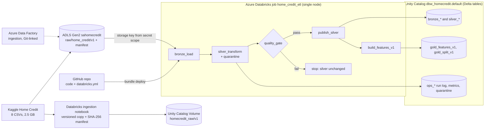
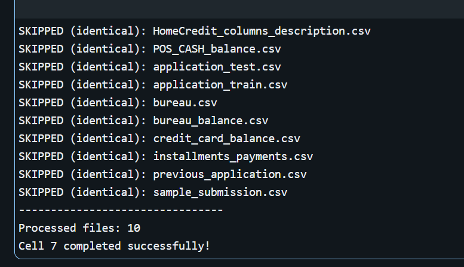
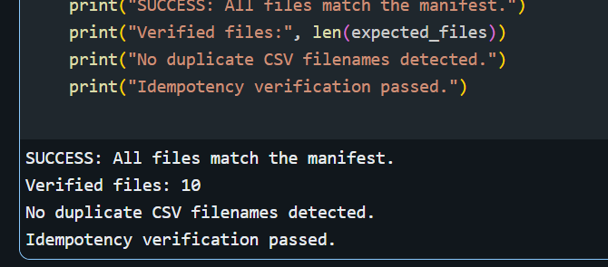
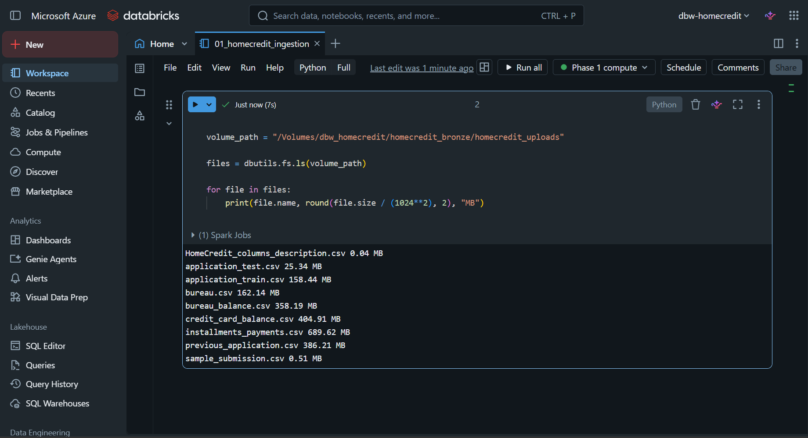

# Predicting Loan Default with Borrowing-History Features

DSAI3202 Fall 2026, Project Phase 1: data pipeline, ETL and features.
Team: Lercia · Noor

## Project and hypothesis

* **Problem:** predict whether a loan applicant will have trouble repaying, to help decide
  to approve, review or reject applicants with little credit history.
* **Target:** `TARGET` in `application_train` (1 = payment difficulties, 0 = no
  difficulties; about 8 % are 1).
* **Baseline plan:** logistic regression using only the application form. Comparison:
  LightGBM using the application form plus borrowing history. Control: LightGBM using only
  the application form. All three use the same fixed 80/20 split (`gold_split_v1`).
* **Hypothesis:** adding borrowing-history features (credit bureau, previous applications,
  past repayments) improves ROC-AUC by at least **0.03** compared with the application form
  alone.
* **Approved refinements:** None.

## Dataset and architecture

* **Source link:** [Home Credit Default Risk (Kaggle)](https://www.kaggle.com/c/home-credit-default-risk/data)
* **Size:** 8 CSV tables + 1 column-description file, about 2.5 GB, 58,489,893 rows.
* **Versions:**
  * Input: raw folder `v1` in `abfss://raw@sahomecredit.dfs.core.windows.net/home_credit/v1/`,
    with a manifest of file names, sizes and SHA-256 hashes (copy: [docs/manifest_v1.json](docs/manifest_v1.json)).
  * Code: the git commit, saved on every output table (`hc.git_commit`).
  * Outputs: Delta table versions (see Results and features).
* **Schema:** tables, keys, types, assumptions and cleaning rules in
  [docs/data_dictionary.md](docs/data_dictionary.md); every column (type, missing %, range,
  description) in [docs/data_dictionary_columns.md](docs/data_dictionary_columns.md); links
  from raw files to outputs in [docs/lineage.md](docs/lineage.md).
* **Storage layout:**

  | Layer | Location | Content |
  |---|---|---|
  | raw | `sahomecredit` container `raw`, folder `home_credit/v1/` | original CSVs + manifest, never changed |
  | bronze | `dbw_homecredit.default.bronze_<table>` | exact copy of the CSVs, all values as text |
  | silver | `dbw_homecredit.default.silver_<table>` | typed, cleaned, no duplicates |
  | gold | `dbw_homecredit.default.gold_features_v1`, `gold_split_v1` | features and train/test split |
  | ops | `dbw_homecredit.default.ops_*` | run log, row counts, quality results, rejected rows |

  All tables are Delta tables in Unity Catalog. They share one schema (`default`) with a
  layer prefix because students cannot create new schemas in our course workspace.
* **Architecture diagram** (Azure services and their roles):



### Azure setup and raw ingestion (Lercia)

* **Resource group:** `rg-homecredit` in subscription `UDST-CCIT-DSAI3202-2`.
* **Storage:** ADLS Gen2 account `sahomecredit`, container `raw`; raw dataset uploaded to
  `home_credit/v1/`. The upload contains the eight pipeline input CSVs,
  `HomeCredit_columns_description.csv`, `manifest.json`, and the optional
  `sample_submission.csv` (11 objects total). The submission CSV is not one of the
  eight ETL inputs.
* **Databricks:** workspace `dbw-homecredit`; Unity Catalog catalog `dbw_homecredit`.
  The initial ingestion notebook used the managed volume
  `/Volumes/dbw_homecredit/homecredit_bronze/homecredit_uploads/` and its versioned
  `homecredit_raw/v1/` folder. This is distinct from the ADLS Gen2 raw path above.
* **Notebook:** `01_homecredit_ingestion` implements versioned copying, SHA-256 manifest
  creation/checking, and an idempotent rerun that skips unchanged files. The notebook
  also tested deliberate hash-mismatch detection and checked that original files
  remained intact. Notebook: [`notebooks/01_homecredit_ingestion.ipynb`](notebooks/01_homecredit_ingestion.ipynb).
* **Azure Data Factory:** factory `adf-homecredit-lercia` was created and connected to
  this GitHub repository with `/adf` as the root folder for version control. The initial
  Home Credit dataset was uploaded directly to ADLS Gen2 rather than through an ADF Copy activity.
* **Manifest verification:** the manifest was uploaded to the ADLS folder; a complete
  destination-side SHA-256 comparison for all 10 CSVs has not yet been
  documented. The original notebook hash test is separate from this check.

### Raw ingestion notebook evidence (Lercia)

The following screenshots document the notebook's file manifest, repeat-run behavior,
validation checks, and dataset accessibility. All paths are relative to this repository.

**Figure 1 — SHA-256 manifest verification (dataset `v1`).** The notebook lists 10 CSV files
and their SHA-256 hashes and reports that manifest verification completed.


**Figure 2 — Idempotent rerun.** All 10 unchanged CSV files were identified as identical
and skipped during a repeated notebook execution.



**Figure 3 — File integrity and duplicate checks.** The notebook reports that all 10 files
match its manifest, no duplicate CSV filenames were detected, and the idempotency check passed.



**Figure 4 — Dataset accessibility and source file sizes.** The notebook lists the Home Credit
CSV files available in the Databricks Unity Catalog volume, including their individual sizes.
This is a source-file inspection, not the CSV-versus-Delta benchmark.



**Notebook controlled failure test.** A deliberately modified test copy produced a different
SHA-256 hash and triggered `ValueError: INGESTION FAILED: File integrity verification failed.`
This notebook-level test is separate from the Databricks Job quality-gate failure documented
under Results and features. The repository screenshot `04_controlled_failure.png` documents
the Job-level test, not the notebook hash-mismatch test.

## Run the pipeline

* **Prerequisites:** the Azure resources above (resource group, ADLS Gen2 `sahomecredit`,
  Databricks workspace `dbw-homecredit` with Unity Catalog) and the raw folder `v1` uploaded
  to ADLS Gen2.
* **Dependencies:** Python 3.10+, Databricks CLI ≥ 0.230 (`brew install databricks/tap/databricks`),
  `pip install -r requirements-dev.txt`. The job runs on Databricks Runtime 15.4 LTS
  (single node `Standard_D4ds_v5`).
* **Permissions:** workspace access with cluster creation, `USE CATALOG` on `dbw_homecredit`,
  `CREATE TABLE` on `dbw_homecredit.default`, and the key of the storage account
  `sahomecredit` (creating an Access Connector is blocked by the course policy, so the job
  reads ADLS with the account key).
* **Configuration:** workspace, storage account, catalog and raw version are set in
  `databricks.yml`. One-time setup of the login and the storage key (kept in a Databricks
  secret, never in Git):

  ```bash
  databricks auth login --host https://adb-7405604671478132.12.azuredatabricks.net
  databricks secrets create-scope hc
  read -s "KEY?Paste key1 of sahomecredit (Access keys): "
  databricks secrets put-secret hc sahomecredit-key --string-value "$KEY" && unset KEY
  ```
* **Execution commands:**

  ```bash
  databricks bundle deploy -t dev                    # creates the job
  databricks bundle run -t dev home_credit_etl       # runs it on raw version v1
  # controlled failure test on a separate bad input:
  databricks bundle run -t dev home_credit_etl --params raw_root=/Volumes/dbw_homecredit/default/raw/home_credit,source_version=test_bad_v1,enforce_expected_rows=false
  pytest -q                                          # 12 unit tests (local)
  ```

  The job runs 5 steps in this order:
  `bronze_load → silver_transform → quality_gate → publish_silver → build_features_v1`.

## Results and features

* **Run IDs** (job `68730613515617`):

  | Run | Run ID | Result |
  |---|---|---|
  | Full run on real data (`v1`) | `933468886966780` | succeeded, 40 min ([screenshot](docs/evidence/01_job_run_success.png)) |
  | Safe rerun (same input) | `854216896755038` | succeeded, identical results |
  | Controlled failure (`test_bad_v1`) | `1032959196744401` | stopped at the quality gate, as intended ([screenshot](docs/evidence/04_controlled_failure.png)) |

* **Output paths and versions:** `dbw_homecredit.default.silver_<table>`,
  `gold_features_v1` and `gold_split_v1`. Each table stores its run ID, input version and
  git commit as table properties; `DESCRIBE HISTORY <table>` shows its Delta versions.
  Tables are registered in Unity Catalog with descriptions, column comments and a primary
  key ([screenshot](docs/evidence/02_catalog_registration.png)), and Unity Catalog records
  the lineage ([screenshot](docs/evidence/03_lineage.png)).
* **Row accounting** (run `933468886966780`, rows in = accepted + rejected for every table):

  | Table | Rows in | Accepted | Rejected |
  |---|---:|---:|---:|
  | application_train | 307,511 | 307,511 | 0 |
  | application_test | 48,744 | 48,744 | 0 |
  | bureau | 1,716,428 | 1,716,428 | 0 |
  | bureau_balance | 27,299,925 | 27,299,925 | 0 |
  | previous_application | 1,670,214 | 1,670,214 | 0 |
  | installments_payments | 13,605,401 | 13,605,401 | 0 |
  | pos_cash_balance | 10,001,358 | 10,001,358 | 0 |
  | credit_card_balance | 3,840,312 | 3,840,312 | 0 |
  | **Total** | **58,489,893** | **58,489,893** | **0** |

  The real data had no type errors or duplicates. Cleaning replaced placeholder values with
  NULL (for example `DAYS_EMPLOYED = 365243` in 55,374 rows, kept as a flag). Rejected rows
  go to `ops_quarantine` with the reason.
* **Quality checks:** silver handles missing values (empty text → NULL, missing ID →
  rejected), types (values that cannot be converted → rejected) and duplicates (exact
  copies and ID conflicts → rejected). Publication **stops** if any of these fails: a
  required column is missing, rows in ≠ accepted + rejected, a table is empty, more than
  1 % of rows are rejected, an ID is duplicated, the default rate is outside 5–12 %, or
  train and test share IDs. Other checks (many NULLs, orphan rows) only warn. Full run:
  58 checks, 0 blocking failures. Details: [docs/data_dictionary.md](docs/data_dictionary.md).
* **Rerun check:** the rerun skipped `bronze_load` for all 8 tables (`skipped_unchanged`)
  and produced the same counts, so nothing was duplicated. Note: the file hashes were not
  saved in the bronze tables in these runs (manifest field-name mismatch, fixed afterwards).
* **Controlled failure:** a separate test input `test_bad_v1` (500 made-up applicants with
  planted errors, from `scripts/make_synthetic_sample.py --inject-errors`) was run through
  the job. 15.86 % of `application_train` rows were rejected (limit 1 %), so `quality_gate`
  failed, `publish_silver` and `build_features_v1` were skipped, and the published tables
  stayed unchanged. The bronze tables now hold this test sample until the next `v1` run.
  The ingestion notebook ([notebooks/01_homecredit_ingestion.ipynb](notebooks/01_homecredit_ingestion.ipynb))
  also tests that a corrupted file is detected by its SHA-256 hash.
* **EDA findings** ([notebooks/01_eda.ipynb](notebooks/01_eda.ipynb), all rows; one labelled
  5 % sample is used only for a scatter plot; charts in `docs/eda/`):
  * 8.07 % of applicants default, so we use ROC-AUC, not accuracy, and a stratified split.
  * 41 of 121 application columns are more than half empty (`EXT_SOURCE_1`: 56 %). They
    stay NULL and are filled in during training only, using the training split.
  * Income has extreme outliers (max is 248× the 99th percentile), so we use ratios such as
    credit ÷ income.
  * The strongest single signals are the external scores `EXT_SOURCE_1–3`. Their timing is
    unknown, so Phase 2 will report results with and without them.
  * Applicants who were late on more than 20 % of past installments default at 11.9 %,
    versus 6.8 % for those never late: the history signal the hypothesis needs.
* **Feature definitions:** `gold_features_v1` has 50 features in two groups, 24 from the
  application form and 26 from borrowing history, one row per applicant (356,255 rows).
  `gold_split_v1` is a fixed stratified 80/20 split (seed 3202; 8.07 % defaults in both
  parts). Each feature's definition, type, source and availability at prediction time, plus
  the leakage risks, are in [docs/feature_spec.md](docs/feature_spec.md).

## Resource use and contributions

* **Cost and performance choice (Lercia):** We compared CSV and Delta formats using the same
  307,511 rows from `application_train.csv` (ingestion notebook, measurement saved as
  `phase1_measurements.json`). CSV occupied 158.4 MB and required 4.18 seconds to read.
  Delta occupied 23.5 MB, required 2.21 seconds to read, and took 14.57 seconds to write.
  Delta reduced measured storage size by approximately 85% and improved read performance
  by approximately 47%. We therefore selected CSV for preserving the original raw dataset
  and Delta for processed Bronze, Silver and Gold tables, where efficient queries and
  reliable updates are important.
* **Cleanup (Lercia):** The ingestion notebook
  ([notebooks/01_homecredit_ingestion.ipynb](notebooks/01_homecredit_ingestion.ipynb))
  includes a cleanup step that removes temporary files generated during the controlled
  failure test. The cleanup verification confirmed that the temporary failure-test folder
  was removed while the original versioned dataset and its manifest remained intact.
  Azure resources should be stopped or deleted after grading to prevent unnecessary costs.
  To control ongoing costs after grading: terminate the Databricks compute;
  stop scheduled job triggers; inspect ADF pipeline triggers and disable any active
  ones; review Azure storage and other billable resources; delete the resource group
  only after the team has backed up evidence and confirmed the instructor no longer
  needs the live resources. Deleting the resource group permanently removes its
  resources and stored data.
* **Each member's work:**
  * Lercia: Created the Azure resource group, ADLS Gen2 storage account/container,
    Databricks workspace and Unity Catalog volume; uploaded the versioned raw dataset
    and manifest to ADLS; developed and tested notebook-level SHA-256 manifest checks,
    unchanged-file skipping, deliberate hash-mismatch detection and temporary-file
    cleanup; measured CSV-versus-Delta size and read performance; and created Azure
    Data Factory with GitHub integration. The raw dataset upload was performed directly
    through Azure Storage, not through an ADF Copy pipeline.
  * Noor: ETL bronze → silver with quarantine; quality gate, row accounting and the
    Databricks job; data dictionary, lineage and Unity Catalog registration; EDA notebook;
    feature set v1, split and feature spec; unit tests; full run, safe rerun and
    controlled failure run on Databricks.
* **Reused code and adaptations:**
  * Noor's part: none; written for this project.
  * Lercia's part: Referenced Lab 03 for Azure environment setup and applied data
    engineering concepts from Labs 04–06 when developing the Databricks notebook.
    No lab code was copied directly; the notebook's
    SHA-256 validation, idempotent rerun, controlled failure and performance comparison
    were adapted to this project's requirements.

## AI use

Lercia's disclosure:

| Tool | Request | Response | Our changes / checks |
|---|---|---|---|
| ChatGPT (OpenAI), used by Lercia | Assistance for Azure resource setup, Databricks ingestion| Suggested Azure setup methods, notebook code debugging and troubleshooting steps, | Lercia executed the ingestion notebook and tests in the course workspace, resolved file-path and volume errors, uploaded the required CSVs and manifest to ADLS, and configured ADF Git integration. Lercia ran the notebook-level controlled failure test (hash mismatch) and confirmed it stopped as expected. |

Noor's disclosure:

| Tool | Request | Response | Our changes / checks |
|---|---|---|---|
| Claude | Help with repetitive setup, syntax, and Azure troubleshooting during Phase 1. | Helped write starter templates for hc_pipeline, databricks.yml, and unit tests; suggested fixes for Azure permission and secret-scope errors; helped clean up markdown formatting in the README.| Defined the pipeline rules, quarantine/quality checks (BLOCK/WARN), and leakage filters, and reviewed all code. Ran full EDA and resolved the DAYS_REGISTRATION decimal edge case (DOUBLE). Adjusted the deployment for course Azure limits (dbw_homecredit single schema, secret scopes), ran all pipeline tests, initialized the repo, and coordinated manifest specs with Lercia.|
| Claude | Check Azure/Databricks errors and format README results. | Suggested troubleshooting steps for workspace permission and secret-config errors; helped format the README tables and results. | Adjusted the job to dbw_homecredit (default schema, prefixed tables) and ADLS secret scopes due to student catalog limits. Set up the CLI, ran all rehearsal/full/failure jobs, created the GitHub repo, and aligned manifest specs with Lercia.|
