# Predicting Loan Default with Borrowing-History Features

DSAI3202 Fall 2026, Project Phase 2: model training, evaluation and deployment (builds on the Phase 1 pipeline).
Team: Noor (60300690) · Lercia (60306713)

## Project and hypothesis

* **Problem:** predict whether a loan applicant will have trouble repaying, to help decide
  to approve, review or reject applicants with little credit history.
* **Target:** `TARGET` in `application_train` (1 = payment difficulties, 0 = no
  difficulties; about 8 % are 1).
* **Baseline plan:** logistic regression using only the application form. Comparison:
  LightGBM using the application form plus borrowing history. Control: LightGBM using only
  the application form. All three use the same split (`gold_split_tvt_v1`): the fixed Phase 1
  80/20 split, with 20 % of the training part held out for validation.
* **Hypothesis:** adding borrowing-history features (credit bureau, previous applications,
  past repayments) improves ROC-AUC by at least **0.03** compared with the application form
  alone.
* **Approved refinements:** None to the hypothesis. In Phase 2 the decision rule gained a
  confidence-interval condition (supported only if the gain is at least 0.03 **and** the 95 %
  bootstrap CI is above 0). It was committed in `f1cf4d2` on 24 Nov 2026, before the test set
  was scored. The verdict is the same under a stricter rule (CI lower bound ≥ 0.03).

## Dataset and architecture

* **Source link:** [Home Credit Default Risk (Kaggle)](https://www.kaggle.com/c/home-credit-default-risk/data)
* **Size:** 8 CSV tables + 1 column-description file, about 2.5 GB, 58,489,893 rows.
* **Versions:**
  * Input: raw folder `v1` in `abfss://raw@sahomecredit.dfs.core.windows.net/home_credit/v1/`,
    with a manifest of file names, sizes and SHA-256 hashes (copy: [docs/manifest_v1.json](docs/manifest_v1.json)).
  * Code: the git commit, saved on every output table (`hc.git_commit`).
  * Outputs: Delta table versions (see Results and features).
* **Schema:** tables, keys, types, assumptions and cleaning rules in
  [docs/data_dictionary.md](docs/data_dictionary.md); every column (type, missing %, range,
  description) in [docs/data_dictionary_columns.md](docs/data_dictionary_columns.md); links
  from raw files to outputs in [docs/lineage.md](docs/lineage.md).
* **Storage layout:**

  | Layer | Location | Content |
  |---|---|---|
  | raw | `sahomecredit` container `raw`, folder `home_credit/v1/` | original CSVs + manifest, never changed |
  | bronze | `dbw_homecredit.default.bronze_<table>` | exact copy of the CSVs, all values as text |
  | silver | `dbw_homecredit.default.silver_<table>` | typed, cleaned, no duplicates |
  | gold | `dbw_homecredit.default.gold_features_v1`, `gold_split_v1` | features and train/test split |
  | ops | `dbw_homecredit.default.ops_*` | run log, row counts, quality results, rejected rows |

  All tables are Delta tables in Unity Catalog. They share one schema (`default`) with a
  layer prefix because students cannot create new schemas in our course workspace.
* **Architecture diagram** (Azure services and their roles):

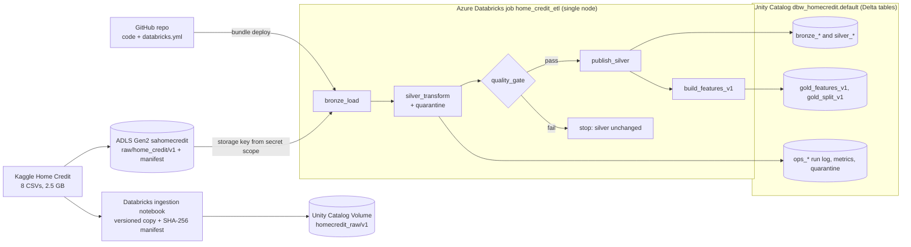

### Azure setup and raw ingestion (Lercia)

* **Resource group:** `rg-homecredit` in subscription `UDST-CCIT-DSAI3202-2`.
* **Storage:** ADLS Gen2 account `sahomecredit`, container `raw`; raw dataset uploaded to
  `home_credit/v1/`. The upload contains the eight pipeline input CSVs,
  `HomeCredit_columns_description.csv`, `manifest.json`, and the optional
  `sample_submission.csv` (11 objects total). The submission CSV is not one of the
  eight ETL inputs.
* **Databricks:** workspace `dbw-homecredit`; Unity Catalog catalog `dbw_homecredit`.
  The initial ingestion notebook used the managed volume
  `/Volumes/dbw_homecredit/homecredit_bronze/homecredit_uploads/` and its versioned
  `homecredit_raw/v1/` folder. This is distinct from the ADLS Gen2 raw path above.
* **Notebook:** `01_homecredit_ingestion` implements versioned copying, SHA-256 manifest
  creation/checking, and an idempotent rerun that skips unchanged files. The notebook
  also tested deliberate hash-mismatch detection and checked that original files
  remained intact. Notebook: [`notebooks/01_homecredit_ingestion.ipynb`](notebooks/01_homecredit_ingestion.ipynb).
* **Azure Data Factory:** factory `adf-homecredit-lercia` was created and connected to
  this GitHub repository with `/adf` as the root folder for version control. The initial
  Home Credit dataset was uploaded directly to ADLS Gen2 rather than through an ADF Copy activity.
* **Manifest verification:** the manifest was uploaded to the ADLS folder; a complete
  destination-side SHA-256 comparison for all 10 CSVs has not yet been
  documented. The original notebook hash test is separate from this check.

### Raw ingestion notebook evidence (Lercia)

The following screenshots document the notebook's file manifest, repeat-run behavior,
validation checks, and dataset accessibility. All paths are relative to this repository.

**Figure 1 — SHA-256 manifest verification (dataset `v1`).** The notebook lists 10 CSV files
and their SHA-256 hashes and reports that manifest verification completed.

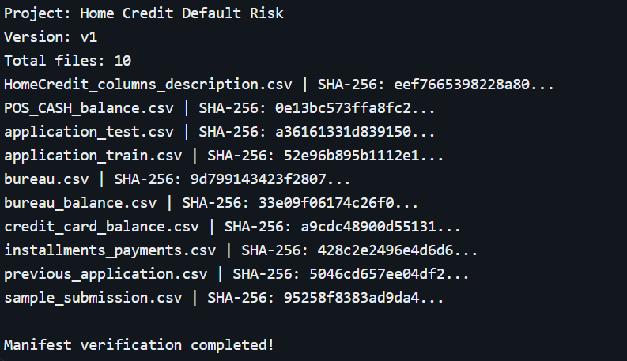

**Figure 2 — Idempotent rerun.** All 10 unchanged CSV files were identified as identical
and skipped during a repeated notebook execution.


**Figure 3 — File integrity and duplicate checks.** The notebook reports that all 10 files
match its manifest, no duplicate CSV filenames were detected, and the idempotency check passed.


**Figure 4 — Dataset accessibility and source file sizes.** The notebook lists the Home Credit
CSV files available in the Databricks Unity Catalog volume, including their individual sizes.
This is a source-file inspection, not the CSV-versus-Delta benchmark.


**Notebook controlled failure test.** A deliberately modified test copy produced a different
SHA-256 hash and triggered `ValueError: INGESTION FAILED: File integrity verification failed.`
This notebook-level test is separate from the Databricks Job quality-gate failure documented
under Results and features. The repository screenshot `04_controlled_failure.png` documents
the Job-level test, not the notebook hash-mismatch test.

### Azure Data Factory Copy activity — successful debug run (Lercia)

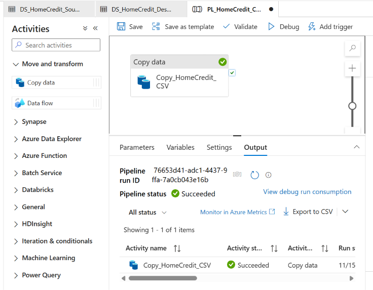

**Figure 7.** Azure Data Factory `PL_HomeCredit_Copy` debug execution showing the `Copy_HomeCredit_CSV` activity succeeded.

## Run the pipeline

* **Prerequisites:** the Azure resources above (resource group, ADLS Gen2 `sahomecredit`,
  Databricks workspace `dbw-homecredit` with Unity Catalog) and the raw folder `v1` uploaded
  to ADLS Gen2.
* **Dependencies:** Python 3.10+, Databricks CLI ≥ 0.230 (`brew install databricks/tap/databricks`),
  `pip install -r requirements-dev.txt`. The job runs on Databricks Runtime 15.4 LTS
  (single node `Standard_D4ds_v5`).
* **Permissions:** workspace access with cluster creation, `USE CATALOG` on `dbw_homecredit`,
  `CREATE TABLE` on `dbw_homecredit.default`, and the key of the storage account
  `sahomecredit` (creating an Access Connector is blocked by the course policy, so the job
  reads ADLS with the account key).
* **Configuration:** workspace, storage account, catalog and raw version are set in
  `databricks.yml`. One-time setup of the login and the storage key (kept in a Databricks
  secret, never in Git):

  ```bash
  databricks auth login --host https://adb-7405604671478132.12.azuredatabricks.net
  databricks secrets create-scope hc
  read -s "KEY?Paste key1 of sahomecredit (Access keys): "
  databricks secrets put-secret hc sahomecredit-key --string-value "$KEY" && unset KEY
  ```
* **Execution commands:**

  ```bash
  databricks bundle deploy -t dev                    # creates the job
  databricks bundle run -t dev home_credit_etl       # runs it on raw version v1
  # controlled failure test on a separate bad input:
  databricks bundle run -t dev home_credit_etl --params raw_root=/Volumes/dbw_homecredit/default/raw/home_credit,source_version=test_bad_v1,enforce_expected_rows=false
  pytest -q                                          # 20 unit tests (local)
  ```

  The job runs 5 steps in this order:
  `bronze_load → silver_transform → quality_gate → publish_silver → build_features_v1`.

## Results and features

* **Run IDs** (job `68730613515617`):

  | Run | Run ID | Result |
  |---|---|---|
  | Full run on real data (`v1`) | `933468886966780` | succeeded, 40 min ([screenshot](docs/evidence/01_job_run_success.png)) |
  | Safe rerun (same input) | `854216896755038` | succeeded, identical results |
  | Controlled failure (`test_bad_v1`) | `1032959196744401` | stopped at the quality gate, as intended ([screenshot](docs/evidence/04_controlled_failure.png)) |

* **Output paths and versions:** `dbw_homecredit.default.silver_<table>`,
  `gold_features_v1` and `gold_split_v1`. Each table stores its run ID, input version and
  git commit as table properties; `DESCRIBE HISTORY <table>` shows its Delta versions.
  Tables are registered in Unity Catalog with descriptions, column comments and a primary
  key ([screenshot](docs/evidence/02_catalog_registration.png)), and Unity Catalog records
  the lineage ([screenshot](docs/evidence/03_lineage.png)).
* **Row accounting** (run `933468886966780`, rows in = accepted + rejected for every table):

  | Table | Rows in | Accepted | Rejected |
  |---|---:|---:|---:|
  | application_train | 307,511 | 307,511 | 0 |
  | application_test | 48,744 | 48,744 | 0 |
  | bureau | 1,716,428 | 1,716,428 | 0 |
  | bureau_balance | 27,299,925 | 27,299,925 | 0 |
  | previous_application | 1,670,214 | 1,670,214 | 0 |
  | installments_payments | 13,605,401 | 13,605,401 | 0 |
  | pos_cash_balance | 10,001,358 | 10,001,358 | 0 |
  | credit_card_balance | 3,840,312 | 3,840,312 | 0 |
  | **Total** | **58,489,893** | **58,489,893** | **0** |

  The real data had no type errors or duplicates. Cleaning replaced placeholder values with
  NULL (for example `DAYS_EMPLOYED = 365243` in 55,374 rows, kept as a flag). Rejected rows
  go to `ops_quarantine` with the reason.
* **Quality checks:** silver handles missing values (empty text → NULL, missing ID →
  rejected), types (values that cannot be converted → rejected) and duplicates (exact
  copies and ID conflicts → rejected). Publication **stops** if any of these fails: a
  required column is missing, rows in ≠ accepted + rejected, a table is empty, more than
  1 % of rows are rejected, an ID is duplicated, the default rate is outside 5–12 %, or
  train and test share IDs. Other checks (many NULLs, orphan rows) only warn. Full run:
  58 checks, 0 blocking failures. Details: [docs/data_dictionary.md](docs/data_dictionary.md).
* **Rerun check:** the rerun skipped `bronze_load` for all 8 tables (`skipped_unchanged`)
  and produced the same counts, so nothing was duplicated. Note: the file hashes were not
  saved in the bronze tables in these runs (manifest field-name mismatch, fixed afterwards).
* **Controlled failure:** a separate test input `test_bad_v1` (500 made-up applicants with
  planted errors, from `scripts/make_synthetic_sample.py --inject-errors`) was run through
  the job. 15.86 % of `application_train` rows were rejected (limit 1 %), so `quality_gate`
  failed, `publish_silver` and `build_features_v1` were skipped, and the published tables
  stayed unchanged. The bronze tables now hold this test sample until the next `v1` run.
  The ingestion notebook ([notebooks/01_homecredit_ingestion.ipynb](notebooks/01_homecredit_ingestion.ipynb))
  also tests that a corrupted file is detected by its SHA-256 hash.
* **EDA findings** ([notebooks/01_eda.ipynb](notebooks/01_eda.ipynb), all rows; one labelled
  5 % sample is used only for a scatter plot; charts in `docs/eda/`):
  * 8.07 % of applicants default, so we use ROC-AUC, not accuracy, and a stratified split.
  * 41 of 121 application columns are more than half empty (`EXT_SOURCE_1`: 56 %). They
    stay NULL and are filled in during training only, using the training split.
  * Income has extreme outliers (max is 248× the 99th percentile), so we use ratios such as
    credit ÷ income.
  * The strongest single signals are the external scores `EXT_SOURCE_1–3`. Their timing is
    unknown, so Phase 2 will report results with and without them.
  * Applicants who were late on more than 20 % of past installments default at 11.9 %,
    versus 6.8 % for those never late: the history signal the hypothesis needs.
* **Feature definitions:** `gold_features_v1` has 50 features in two groups, 24 from the
  application form and 26 from borrowing history, one row per applicant (356,255 rows).
  `gold_split_v1` is a fixed stratified 80/20 split (seed 3202; 8.07 % defaults in both
  parts). Each feature's definition, type, source and availability at prediction time, plus
  the leakage risks, are in [docs/feature_spec.md](docs/feature_spec.md).

## Model and evaluation

* **Code:** `notebooks/02_train_evaluate.py` and `src/hc_pipeline/modeling.py`, run on
  Databricks Runtime 19. Versions, seeds and the data snapshot hash are in
  [run_record.json](docs/evidence/phase2/run_record.json).
* **Data:** feature set v1 (Delta version 5), 50 features, saved as a fixed snapshot
  `features_v1_delta5_tvt1.parquet`.
* **Split:** train 196,807 / validation 49,202 / test 61,502 (about 8% defaults in each).
  Validation is 20% of each class from the Phase-1 train set (seed 3203). The test set is
  used only once, at the end. Preprocessing is fitted on train only.
  A random (stratified) split is the right choice here: the data has no application dates,
  so a time-based split is not possible, and there is exactly one row per application
  (`SK_ID_CURR`), so no application appears in both train and test. Borrowing-history
  features use only records from before the application (their `DAYS_*` values are
  negative, counted back from the application date); see [docs/feature_spec.md](docs/feature_spec.md).
* **Models:** logistic regression (baseline) and LightGBM, trained on application features
  only and on application + history. LightGBM handles missing values and imbalanced data well.
  Settings were chosen on validation AUC: 12 LightGBM settings (`num_leaves` 15/31/63 ×
  `min_child_samples` 50/200 × `reg_lambda` 0/5, defined in `LGBM_GRID` in
  [modeling.py](src/hc_pipeline/modeling.py)). Gender is not used.
* **Decision rule (set before testing):** supported if history adds at least 0.03 AUC and the
  95% CI is above 0.
* **Test results:**

  | Model | Features | ROC-AUC | PR-AUC |
  |---|---|---|---|
  | Logistic regression (baseline) | application | 0.745 | 0.229 |
  | LightGBM | application | 0.765 | 0.252 |
  | **LightGBM (chosen)** | **application + history** | **0.781** | **0.277** |

  Validation AUC (0.773) is close to test AUC (0.781). Validation was also used for tuning and
  early stopping, so the test score is the unbiased estimate. ROC, precision-recall and
  calibration curves: [test_curves.png](docs/evidence/phase2/test_curves.png).
* **Hypothesis: refuted.** History adds +0.0155 AUC (95% CI 0.012 to 0.019), below 0.03.
  Without the `EXT_SOURCE` scores it adds +0.039, so these scores already hold most of the
  history information (extra check, not the main test).
* **Weakest group:** age 60+, AUC 0.732 vs 0.781. Few defaults (4.9%) to learn from, but the
  predicted risk still matches the real rate.
* **Errors:** missed defaulters had good external scores and a clean history; false alarms
  had low scores and late payments but repaid. (Top 5 of each are saved as
  `evidence/confident_errors.csv` in the MLflow parent run `3b066d7a9e824bb7a9daedada09c93d3`,
  together with `tuning_validation.csv` and `feature_importance.csv`.)
* **Top features:** `EXT_SOURCE_MEAN` is about 5× more important than any other;
  10 of the top 20 are history features ([chart](docs/evidence/phase2/feature_importance.png)).
* **Limitations:** relies heavily on external scores; weaker for older applicants; no
  time-based test; outputs a probability (no decision threshold).
* **Run record:** MLflow run `a489fc09f1da4dca8fa2a1187deaad56`. The run recorded commit
  `f1cf4d2`; three small Runtime-19 fixes made during the run were committed as `bf4db2e`.
  To reproduce training, check out `bf4db2e` and run `notebooks/02_train_evaluate.py` on
  Databricks Runtime 19.16 (Python 3.12.3, numpy 2.3.4, pandas 2.3.3, scikit-learn 1.7.2,
  LightGBM 4.5.0, MLflow 3.12.0), with feature table version 5 and split table version 1
  (all in [run_record.json](docs/evidence/phase2/run_record.json)).
* **For deployment:** [model_tags.json](docs/evidence/phase2/model_tags.json),
  [model_input_schema.json](docs/evidence/phase2/model_input_schema.json),
  [consistency_sample_100.json](docs/evidence/phase2/consistency_sample_100.json)
  (100 fixed test rows with the saved model's predictions).

## Traceability and deployment (Phase 2 — Lercia)

| Configuration | Value |
|---|---|
| Resource group | `rg-homecredit` |
| Azure ML workspace | `mlw-homecredit` (Qatar Central) |
| Registered model | `lgbm-app-hist:1` (MLflow) |
| Endpoint | `homecredit-risk-endpoint` |
| Deployment | `blue`, 100% traffic |
| Compute | `Standard_DS3_v2`, one instance |
| Authentication | Key-based; credentials are not committed |
| Environment | `homecredit-inference:1` |

The registered model retains the fitted preprocessing and training run metadata. See the [model tags](docs/evidence/phase2/model_tags.json), [input schema](docs/evidence/phase2/model_input_schema.json) and [registration/deployment notebook](notebooks/Phase2_Model_Registration.ipynb).

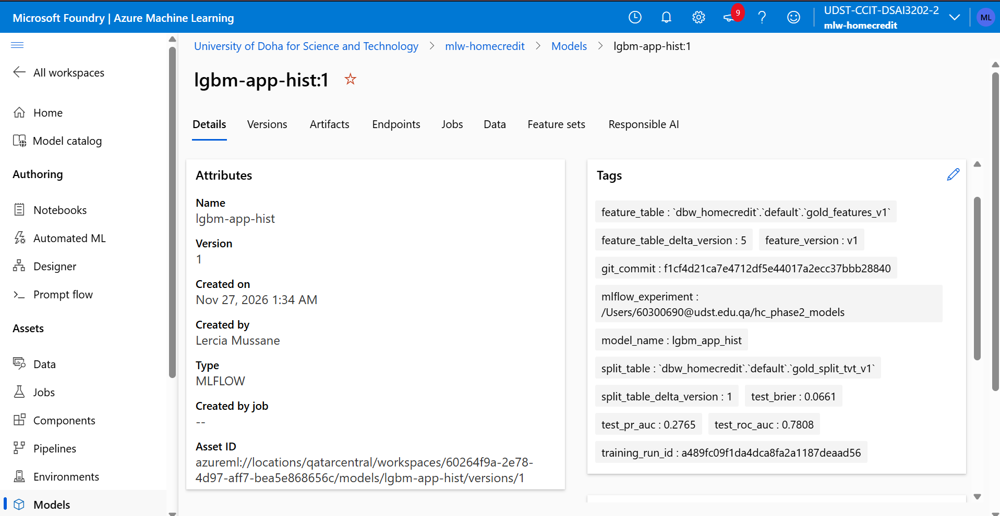

### Deployment and troubleshooting

The initial automatic MLflow deployment failed its health probes because the generated scoring script could not import the `azureml` module. The endpoint itself was created successfully. We replaced automatic scoring with a custom [score.py](deployment/score.py) and [conda.yaml](deployment/conda.yaml), explicitly including the inference HTTP server and model dependencies. The custom script locates the actual model artifact rather than its metadata copy, validates inputs and extracts the positive-class probability. After local tests, the custom deployment succeeded and received 100% of endpoint traffic.

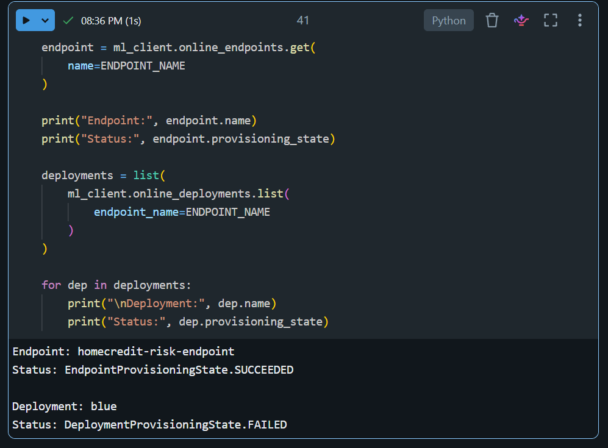

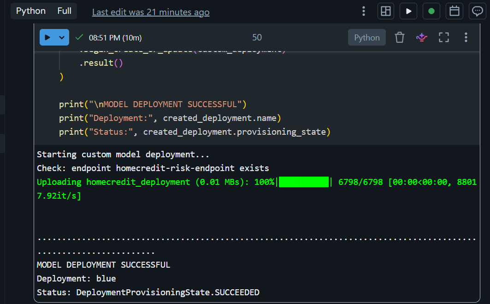

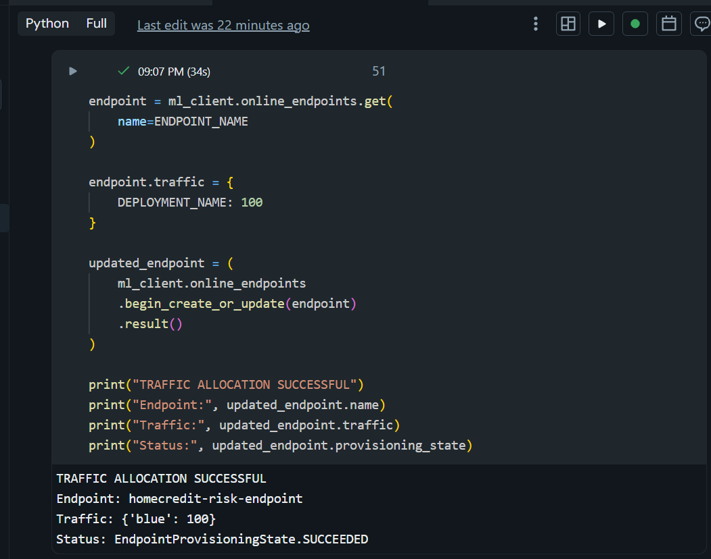

### Input contract and repeatable setup

**What the service accepts.** Computed features for one or more loan applications, not raw
Kaggle tables. Each feature is defined in [docs/feature_spec.md](docs/feature_spec.md) and is
computed by `build_features` in [src/hc_pipeline/features.py](src/hc_pipeline/features.py)
(the Phase-1 job writes them to `gold_features_v1`). Field names and types are in
[model_input_schema.json](docs/evidence/phase2/model_input_schema.json).

| Rule | Detail |
|---|---|
| Body | JSON object `{"inputs": [record, ...]}`, at least one record |
| Record | `SK_ID_CURR` (integer, used only to label the output) plus all 50 feature fields |
| Types | 44 numeric fields as JSON numbers; 6 categorical fields as strings (`NAME_CONTRACT_TYPE`, `CODE_GENDER`, `NAME_INCOME_TYPE`, `NAME_EDUCATION_TYPE`, `FLAG_OWN_CAR`, `FLAG_OWN_REALTY`) |
| Missing values | Send `null`. Every feature is nullable in the schema. Numeric `null`s were checked on the live endpoint (the 100-row consistency sample contains them); `null` categorical values have not been tested |
| `CODE_GENDER` | Must be sent but is ignored by the model |
| Output | `{"predictions": [{"SK_ID_CURR": ..., "probability": ...}]}`, one entry per record in the same order; `probability` is the predicted chance of payment difficulties (0–1), not an approval decision |

*Why the MLflow signature shows 39 required and 11 optional columns:* MLflow inferred the
signature from 5 example rows, and marked as optional the 11 columns that happened to be empty
in those rows. "Required" there only means the field name must be present; its value can still
be `null`. `score.py` rejects a record that leaves out any of the 39, and fills the 11 with
`null` if they are left out. Sending all 50 fields, as above, always works.

**Errors.** `score.py` raises an error (no prediction is returned) when `inputs` is missing,
empty or not a list; when a record is not an object; when a required field is missing; or when
a numeric field holds a value that is not a number. These cases were tested against the scoring
script locally (notebook cell 47). The HTTP status the live endpoint returns for them has not
been verified yet.

**Sample request.** [request_single.json](docs/evidence/phase2/request_single.json) is the first
record of the consistency sample (applicant 100008):

```bash
SCORING_URI=$(az ml online-endpoint show -n homecredit-risk-endpoint \
  -g rg-homecredit -w mlw-homecredit --query scoring_uri -o tsv)
KEY=$(az ml online-endpoint get-credentials -n homecredit-risk-endpoint \
  -g rg-homecredit -w mlw-homecredit --query primaryKey -o tsv)
curl -s -X POST "$SCORING_URI" -H "Authorization: Bearer $KEY" \
  -H "Content-Type: application/json" -d @docs/evidence/phase2/request_single.json
```

<details><summary>Full request body</summary>

```json
{
  "inputs": [
    {
      "SK_ID_CURR": 100008,
      "AMT_INCOME_TOTAL": 99000.0,
      "AMT_CREDIT": 490495.5,
      "AMT_ANNUITY": 27517.5,
      "AMT_GOODS_PRICE": 454500.0,
      "CREDIT_INCOME_RATIO": 4.9545,
      "ANNUITY_INCOME_RATIO": 0.27795454545454545,
      "CREDIT_TERM": 17.824856909239575,
      "GOODS_CREDIT_RATIO": 0.9266140056330792,
      "AGE_YEARS": 46.38193018480493,
      "EMPLOYED_YEARS": 4.347707049965777,
      "DAYS_EMPLOYED_ANOM": 0,
      "EXT_SOURCE_1": null,
      "EXT_SOURCE_2": 0.3542247319929012,
      "EXT_SOURCE_3": 0.6212263380626669,
      "EXT_SOURCE_MEAN": 0.48772553502778404,
      "CNT_CHILDREN": 0.0,
      "CNT_FAM_MEMBERS": 2.0,
      "REGION_RATING_CLIENT": 2.0,
      "NAME_CONTRACT_TYPE": "Cash loans",
      "CODE_GENDER": "M",
      "NAME_INCOME_TYPE": "State servant",
      "NAME_EDUCATION_TYPE": "Secondary / secondary special",
      "FLAG_OWN_CAR": "N",
      "FLAG_OWN_REALTY": "Y",
      "BUR_LOAN_COUNT": 3,
      "BUR_ACTIVE_COUNT": 1,
      "BUR_ACTIVE_DEBT_SUM": 240057.0,
      "BUR_DEBT_CREDIT_RATIO": 0.8970538777157463,
      "BUR_DEBT_INCOME_RATIO": 2.424818181818182,
      "BUR_OVERDUE_SUM": 0.0,
      "BUR_MAX_DAY_OVERDUE": 0.0,
      "BUR_DAYS_SINCE_LAST_CREDIT": 78.0,
      "BB_MONTHS_COUNT": 0,
      "BB_LATE_MONTH_RATE": null,
      "PREV_APP_COUNT": 5,
      "PREV_REFUSED_COUNT": 0,
      "PREV_APPROVED_RATE": 0.8,
      "PREV_CREDIT_APPLICATION_RATIO_MEAN": 0.978568794918514,
      "PREV_DAYS_SINCE_LAST_DECISION": 82.0,
      "INST_COUNT": 34,
      "INST_LATE_RATE": 0.029411764705882353,
      "INST_DPD_MEAN": 38.73529411764706,
      "INST_UNDERPAID_RATE": 0.0,
      "INST_PAID_RATIO": 1.0,
      "POS_MONTHS_COUNT": 83,
      "POS_LATE_MONTH_RATE": 0.5180722891566265,
      "POS_DPD_MAX": 1294.0,
      "CC_MONTHS_COUNT": 0,
      "CC_UTILIZATION_MEAN": null,
      "CC_DPD_MAX": null
    }
  ]
}
```

</details>

Response from the live endpoint (notebook cell 52):

```json
{"predictions": [{"SK_ID_CURR": 100008, "probability": 0.034801695219948824}]}
```

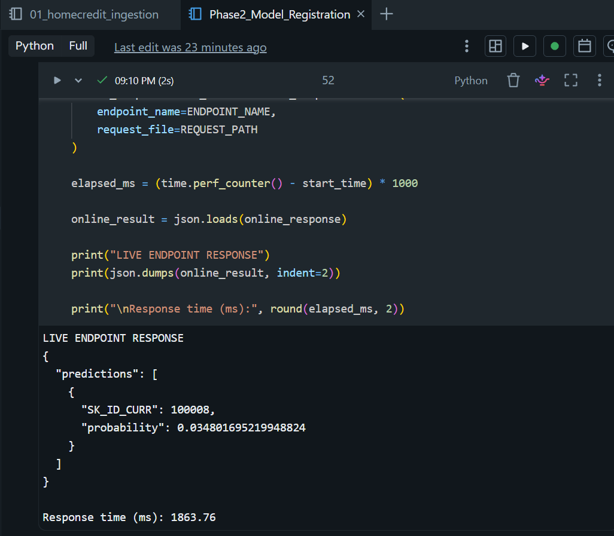

To redeploy, use an authorized Azure account, connect to the workspace, retain or register model version 1, register the custom environment from `conda.yaml`, create the key-authenticated endpoint, and deploy `blue` with the custom scoring script on one `Standard_DS3_v2` instance. Wait for successful provisioning, assign 100% traffic and repeat the endpoint and consistency tests using the notebook. Obtain endpoint credentials through Azure at runtime; do not store them in Git.

## Verification and resource use (Phase 2)

### Functional and consistency checks

Valid live requests succeeded. Empty inputs, missing fields, invalid types and missing required features were tested locally against the custom scoring script; invalid requests were not independently verified on the live endpoint. The same 100 fixed test records were scored offline and online, with tolerance `1e-6` and matching records in the fixed sample order. Both tests matched 100/100 expected predictions, with maximum and mean absolute difference of 0.0.

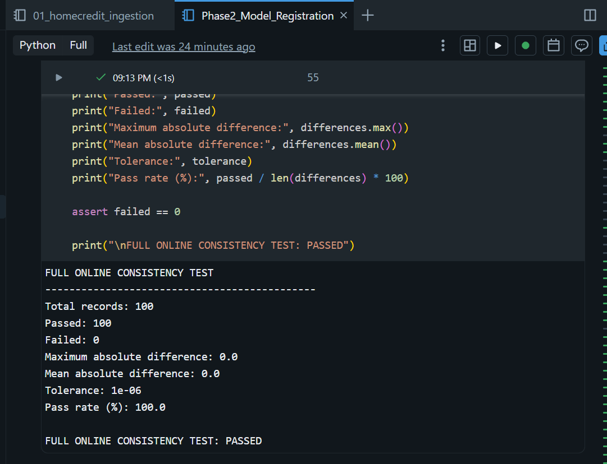

Additional evidence: [local consistency](docs/evidence/phase2/phase2_local_consistency.png), [custom scoring test](docs/evidence/phase2/phase2_custom_scoring_success.png), [environment registration](docs/evidence/phase2/phase2_environment_registered.png).

### Latency and cost

After warm-up, 100 requests were issued from Databricks. All succeeded; timings include client and network overhead.

| Metric | Result |
|---|---:|
| Successful requests | 100/100 |
| Mean | 721.65 ms |
| P50 | 726.97 ms |
| P95 | 877.04 ms |
| P99 | 1165.54 ms |

A proposed demonstration target is P95 below 1 second; the observed result meets it. This target is stated retrospectively, not claimed as a pre-test target. One instance was sufficient for the measured sequential workload; no concurrent-load or autoscaling claim is made.

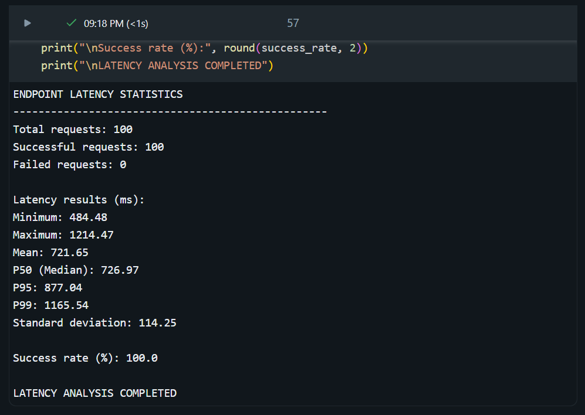

Azure Retail Prices API returned an estimated Linux compute rate of USD 0.275/hour for the selected instance in Qatar Central. At continuous operation, this is USD 6.60/day, USD 46.20/week and USD 198 per 30-day month. These are compute-only estimates, excluding storage, networking and other services. One instance avoids additional replica cost for the demonstration workload.

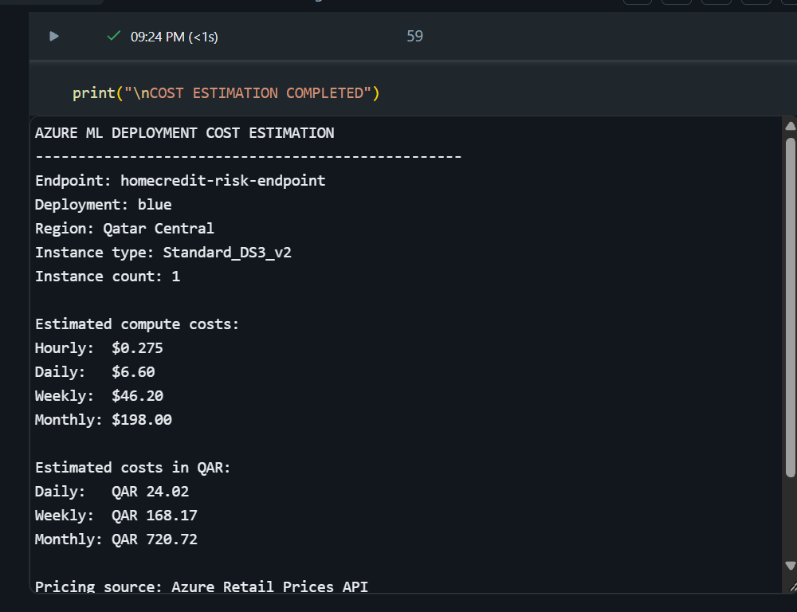

Additional evidence: [pricing lookup](docs/evidence/phase2/phase2_azure_pricing.png), [benchmark success](docs/evidence/phase2/phase2_benchmark_success.png).

### Cleanup plan

Keep the endpoint available through the presentation and D2L assessment window. After grading and team confirmation, delete the managed online endpoint (including its deployment) using Azure ML Studio or `ml_client.online_endpoints.begin_delete(name="homecredit-risk-endpoint").result()`. Verify that it no longer appears in the endpoint list and save deletion evidence. Retain the model, data, configuration and notebook for reproducibility. Cleanup is planned, not yet executed.

### Phase 2 contributions and reused code

* Lercia: Azure ML workspace setup, model registration, deployment troubleshooting, custom scoring and environment configuration, local and online consistency checks, latency benchmarking, cost estimation, cleanup planning and deployment evidence.
* Noor: validation split (20% of each class, seed 3203); model training (logistic regression baseline, LightGBM control on application features, LightGBM candidate with history; 12 settings tuned on validation); one-time test evaluation; bootstrap hypothesis test (1,000 samples); extra no-EXT_SOURCE check; error analysis (slices, confident mistakes, feature importance); deployment hand-off files (model tags, input schema, 100-row consistency sample); 8 new modeling tests (20 total); and the README Model and evaluation section. Both members share documentation, consistency review and presentation preparation.
* Noor's part reused no lab code; it was written for this project.
* Lercia used the Lab 10 managed endpoint workflow as a reference, adapting it to the registered Home Credit MLflow model, custom inference environment, input validation and fixed-sample consistency checks.

## Resource use and contributions

* **Cost and performance choice (Lercia):** We compared CSV and Delta formats using the same
  307,511 rows from `application_train.csv` (ingestion notebook, measurement saved as
  `phase1_measurements.json`). CSV occupied 158.4 MB and required 4.18 seconds to read.
  Delta occupied 23.5 MB, required 2.21 seconds to read, and took 14.57 seconds to write.
  Delta reduced measured storage size by approximately 85% and improved read performance
  by approximately 47%. We therefore selected CSV for preserving the original raw dataset
  and Delta for processed Bronze, Silver and Gold tables, where efficient queries and
  reliable updates are important.
* **Cleanup (Lercia):** The ingestion notebook
  ([notebooks/01_homecredit_ingestion.ipynb](notebooks/01_homecredit_ingestion.ipynb))
  includes a cleanup step that removes temporary files generated during the controlled
  failure test. The cleanup verification confirmed that the temporary failure-test folder
  was removed while the original versioned dataset and its manifest remained intact.
  Azure resources should be stopped or deleted after grading to prevent unnecessary costs.
  To control ongoing costs after grading: terminate the Databricks compute;
  stop scheduled job triggers; inspect ADF pipeline triggers and disable any active
  ones; review Azure storage and other billable resources; delete the resource group
  only after the team has backed up evidence and confirmed the instructor no longer
  needs the live resources. Deleting the resource group permanently removes its
  resources and stored data.
* **Each member's work:**
  * Lercia: Created the Azure resource group, ADLS Gen2 storage account/container,
    Databricks workspace and Unity Catalog volume; uploaded the versioned raw dataset
    and manifest to ADLS; developed and tested notebook-level SHA-256 manifest checks,
    unchanged-file skipping, deliberate hash-mismatch detection and temporary-file
    cleanup; measured CSV-versus-Delta size and read performance; and created Azure
    Data Factory with GitHub integration. The raw dataset upload was performed directly
    through Azure Storage, not through an ADF Copy pipeline.
  * Noor: ETL bronze → silver with quarantine; quality gate, row accounting and the
    Databricks job; data dictionary, lineage and Unity Catalog registration; EDA notebook;
    feature set v1, split and feature spec; unit tests; full run, safe rerun and
    controlled failure run on Databricks.
* **Reused code and adaptations:**
  * Noor's part: none; written for this project.
  * Lercia's part: Referenced Lab 03 for Azure environment setup and applied data
    engineering concepts from Labs 04–06 when developing the Databricks notebook.
    No lab code was copied directly; the notebook's
    SHA-256 validation, idempotent rerun, controlled failure and performance comparison
    were adapted to this project's requirements.


## AI use

Lercia's disclosure:

| Tool | Request | Response | Our changes / checks |
|---|---|---|---|
|**Phase 1**||||
| ChatGPT (OpenAI) | Assistance for Azure resource setup, Databricks ingestion| Suggested Azure setup methods, notebook code debugging and troubleshooting steps, | Lercia executed the ingestion notebook and tests in the course workspace, resolved file-path and volume errors, uploaded the required CSVs and manifest to ADLS, and configured ADF Git integration. Lercia ran the notebook-level controlled failure test (hash mismatch) and confirmed it stopped as expected. |
|**Phase 2**||||
|ChatGPT (Open AI)|Azure ML deployment failure trouble|Analysed the deployment logs and identified a missing azureml Python module that caused the original deployment to fail.|Replaced automatic MLflow deployment with a custom scoring script and inference environment.|
|ChatGPT (OpenAI) |Resolve missing model dependencies.|Identified missing LightGBM and recommended the required version.|Suggested the installation of LightGBM 4.5.0.|
|ChatGPT (OpenAI) |Validate the custom scoring script.|Suggested syntax, initialization and input validation tests.|Tested the script successfully and verified that invalid inputs were rejected.|

Noor's disclosure:

| Tool | Request | Response | Our changes / checks |
|---|---|---|---|
| **Planning (Phases 1–2)** | | | |
| Claude | Turn the course labs into step-by-step plans for the ETL, quality checks and features, and for model training, validation and error analysis. | Gave ordered checklists mapped to the labs: bronze → silver with quarantine, quality gate as a Databricks Job, Unity Catalog registration and lineage, EDA, feature set and stratified split; then train/validation split, baseline vs control vs candidate, test once, bootstrap CI, error analysis and consistency check. | Used them as guides; designed the pipeline rules and checks, wrote the ETL, quality gate, EDA, feature, `02_train_evaluate.py` and `modeling.py` code myself, and ran everything on Databricks. |
| **Phase 1** | | | |
| Claude | Help with repetitive setup, syntax, Azure/Databricks troubleshooting and README formatting. | Helped write starter templates for hc_pipeline, databricks.yml and unit tests; suggested fixes for workspace permission and secret-scope errors; helped format the README tables and results. | Defined the pipeline rules, quarantine/quality checks (BLOCK/WARN) and leakage filters, and reviewed all code. Ran full EDA and resolved the DAYS_REGISTRATION decimal edge case (DOUBLE). Adjusted the job for course limits (dbw_homecredit default schema, prefixed tables, ADLS secret scopes). Set up the CLI, ran all rehearsal/full/failure jobs and pipeline tests, created the GitHub repo, and aligned manifest specs with Lercia. |
| **Phase 2** | | | |
| Claude | Review my training code for mistakes and explain my results for me to understand. | Confirmed no leakage and a correct test-once setup; flagged a hardcoded git-commit fallback, the consistency tolerance, the CI rule wording and an unverified per-class split; explained ROC-AUC, the bootstrap CI, why +0.0155 (CI 0.012–0.019) refutes the 0.03 target, and likely reasons for the weak 60+ group, the confident mistakes and the dominance of EXT_SOURCE_MEAN. | Verified the split myself (exactly 20% per class); recorded both commits (`f1cf4d2` run, `bf4db2e` fixes); chose not to add a decision threshold as the brief does not require it; all numbers come from my own run, and I checked the explanations against my slice and confident-errors outputs and wrote the sections in my own words. |
| Claude | Read-only review of the repo before submission. | Checked README numbers, links and tests, and listed missing items | Verified the findings myself; Lercia and I made the fixes up to commit `da3fe2b` ourselves. |
| Claude | Review my README and list what to fix (read-only, no edits). | Listed fixes: input contract, 39/11 signature note, error cases, sample request and curl, reproduction line, decision-rule note, tuning-grid reference, test-curves link and wording. | I made all the edits myself on GitHub and checked them against my run outputs and the endpoint. |


