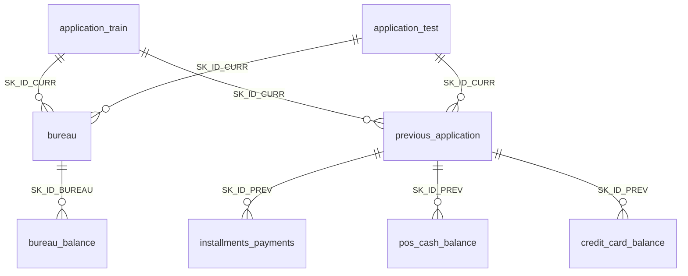

# Data dictionary

Dataset: **Home Credit Default Risk** (Kaggle, 2018). Every column of every table, with
types, null rates, ranges and Kaggle's own description, is in the generated
[data_dictionary_columns.md](data_dictionary_columns.md) (`scripts/build_data_dictionary.py`).
This page covers the parts that need human judgement: tables, keys, relationships, type
rules, cleaning rules and assumptions.

The schema contract lives in code: [`src/hc_pipeline/spec.py`](../src/hc_pipeline/spec.py).
The ETL, the quality gate, the Unity Catalog comments and this dictionary all read from it.

## 1. Tables

Row counts are the documented Kaggle counts. The job compares each load against them
(`volume.expected_rows`, ±1 %).

| Silver table | Raw file | Grain (one row = …) | Primary key | Rows |
|---|---|---|---|---:|
| `application_train` | application_train.csv | one labelled loan application | `SK_ID_CURR` | 307,511 |
| `application_test` | application_test.csv | one unlabelled application | `SK_ID_CURR` | 48,744 |
| `bureau` | bureau.csv | one credit at another institution | `SK_ID_BUREAU` | 1,716,428 |
| `bureau_balance` | bureau_balance.csv | one month of one bureau credit | `SK_ID_BUREAU, MONTHS_BALANCE` | 27,299,925 |
| `previous_application` | previous_application.csv | one earlier Home Credit application | `SK_ID_PREV` | 1,670,214 |
| `installments_payments` | installments_payments.csv | one payment against one installment | none (see note) | 13,605,401 |
| `pos_cash_balance` | POS_CASH_balance.csv | one month of one POS/cash loan | none (see note) | 10,001,358 |
| `credit_card_balance` | credit_card_balance.csv | one month of one credit card | none (see note) | 3,840,312 |

No primary key is declared for the three monthly/payment tables: one installment can be
paid in several rows, and we don't assume `(SK_ID_PREV, MONTHS_BALANCE)` is unique
until the profiler confirms it on the full data. Exact duplicate rows are still removed.

## 2. Relationships

* `SK_ID_CURR` in the history tables can refer to either `application_train` or
  `application_test`. The gate checks that the two application tables share no IDs
  (`cross.train_test_id_overlap`, blocking).
* Orphans (child rows with no parent) are measured but don't block the run
  (`integrity.orphans.*`, warning). For example, `bureau_balance` contains bureau IDs
  that are not in `bureau`. Orphans can't reach an applicant, so the feature joins
  simply drop them.

## 3. Type rules (raw string → silver type)

Bronze keeps every value as the original string. Silver casts with
`try_cast`, and a value that is present but can't be cast is a **type violation**: the row
is quarantined instead of silently becoming NULL.

| Rule | Silver type | Examples |
|---|---|---|
| `SK_ID_*` | bigint | SK_ID_CURR, SK_ID_PREV |
| `TARGET` | int | |
| `DAYS_*`, `MONTHS_BALANCE` (must be whole numbers) | int | DAYS_BIRTH, DAYS_EMPLOYED |
| `NAME_*`, `CODE_*`, `WEEKDAY_*` and listed categoricals | string | FLAG_OWN_CAR (Y/N), STATUS, CREDIT_TYPE, ORGANIZATION_TYPE |
| everything else | double | AMT_*, CNT_*, EXT_SOURCE_*, FLAG_DOCUMENT_* |

Empty strings and surrounding spaces become NULL before casting.

## 4. Cleaning rules (applied to accepted rows)

| Rule | Tables / columns | Why |
|---|---|---|
| `365243` → NULL | `DAYS_EMPLOYED` (applications); `DAYS_FIRST_DRAWING`, `DAYS_FIRST_DUE`, `DAYS_LAST_DUE_1ST_VERSION`, `DAYS_LAST_DUE`, `DAYS_TERMINATION` (previous_application) | Placeholder for "no date" (≈1000 years). Left in, it distorts every mean and scale. |
| `DAYS_EMPLOYED_ANOM` flag (0/1) | applications | The placeholder is informative (mostly pensioners), so the information is kept as a flag. |
| `XNA` / `Unknown` → NULL | `CODE_GENDER`, `ORGANIZATION_TYPE`, `NAME_FAMILY_STATUS`; `NAME_CASH_LOAN_PURPOSE` (`XNA`, `XAP`), `CODE_REJECT_REASON` (`XNA`) | These codes mean "not available", not a real category. |
| Other missing values | all | **Left as NULL in silver.** Imputation is part of model training (fitted on the training split only) to avoid leakage. |

Every cleaned row lists the columns it changed in `_cleaned_cols`, and the job counts
them per run (`ops.table_metrics.cleaned_values`).

## 5. Row rejection rules (→ `ops.quarantine`)

| Reason code | Meaning |
|---|---|
| `type:<COLUMN>` | Value present but not castable to the silver type (or not a whole number for int columns) |
| `malformed_line` | CSV line with the wrong number of fields |
| `null_key:<COLUMN>` | Missing ID column |
| `invalid_target` | TARGET missing or not 0/1 |
| `non_positive_income`, `non_positive_credit` | AMT_INCOME_TOTAL / AMT_CREDIT missing or ≤ 0 |
| `invalid_days_birth` | DAYS_BIRTH missing or ≥ 0 |
| `invalid_status` | bureau_balance STATUS not in C, X, 0–5 |
| `future_month` | MONTHS_BALANCE > 0 (after the application) |
| `negative_amount`, `negative_credit_sum`, `negative_dpd` | Amount or days-past-due < 0 |
| `duplicate_row` | Exact copy of an earlier row (the first copy is kept) |
| `duplicate_key_conflict` | Same primary key, different content. All copies are rejected because we can't tell which one is correct. |

A row can have several reasons. The quarantine keeps the **raw strings** as JSON
(`raw_record`) plus `source_file`, `bronze_row_id` and `run_id`, so each rejection can be
traced back to the exact line of the source file.

## 6. Pipeline-added columns

| Column | Layer | Meaning |
|---|---|---|
| `_source_file`, `_source_version`, `_source_sha256` | bronze | Raw file, version folder and manifest hash |
| `_ingest_run_id`, `_bronze_row_id` | bronze | Job run that loaded the row, row ID within the load |
| `_corrupt_record` | bronze | Raw text of malformed CSV lines (NULL otherwise) |
| `DAYS_EMPLOYED_ANOM` | silver | See §4 |
| `_cleaned_cols` | silver | Columns nullified by cleaning in this row |
| `_silver_run_id` | silver | Job run that produced the row |

## 7. Operational tables (`<catalog>.ops`)

| Table | Content |
|---|---|
| `run_log` | One row per task × table × run: status (`written`, `skipped_unchanged`, `staged`, `passed`/`failed`, `published`), rows, git commit |
| `table_metrics` | Row accounting per run and table (JSON): rows in / accepted / rejected, reasons, cleaned values, null rates, PK duplicates |
| `quality_results` | One row per check per run: severity (BLOCK/WARN), passed, observed, threshold |
| `quarantine` | Rejected rows (see §5), replaced per (table, source_version), so a rerun doesn't duplicate them |

## 8. Assumptions

1. `DAYS_*` and `MONTHS_BALANCE` are relative to the **current application date**
   (negative = before). The leakage guard in the features depends on this.
2. `TARGET` is defined by Home Credit (payment difficulties on early installments) and is
   only available in `application_train`.
3. `EXT_SOURCE_1..3` are normalised scores from external sources whose computation
   date we can't verify (see the leakage notes in [feature_spec.md](feature_spec.md)).
4. Currency amounts are in one (unnamed) currency. `bureau.CREDIT_CURRENCY` is
   anonymised and not converted.
