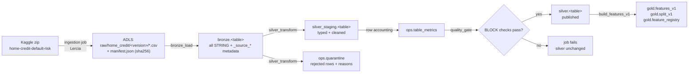

# Lineage

> Table names below use the logical layer names (`bronze.x`, `silver.x`). In our workspace
> they are created as `dbw_homecredit.default.bronze_x`, `silver_x`, `gold_x`, `ops_x` (see README).

## Layer-to-layer



## Raw file → published table

| Raw file (`raw/<version>/`) | Bronze | Silver | Used by features |
|---|---|---|---|
| application_train.csv | bronze.application_train | silver.application_train | application group, TARGET, split |
| application_test.csv | bronze.application_test | silver.application_test | application group (DATASET = 'test') |
| bureau.csv | bronze.bureau | silver.bureau | BUR_* |
| bureau_balance.csv | bronze.bureau_balance | silver.bureau_balance | BB_* (joined through bureau) |
| previous_application.csv | bronze.previous_application | silver.previous_application | PREV_* |
| installments_payments.csv | bronze.installments_payments | silver.installments_payments | INST_* |
| POS_CASH_balance.csv | bronze.pos_cash_balance | silver.pos_cash_balance | POS_* |
| credit_card_balance.csv | bronze.credit_card_balance | silver.credit_card_balance | CC_* |
| HomeCredit_columns_description.csv | (not loaded) | used for column comments | |

## How a row can be traced

* **Row level:** every bronze row has `_source_file`, `_source_version`,
  `_source_sha256` and `_bronze_row_id`. Silver keeps `_source_file`,
  `_source_version`, `_silver_run_id` and `_cleaned_cols`. Quarantine keeps
  `source_file`, `bronze_row_id`, `run_id` and the raw values.
* **Table level:** each table carries properties set by the job:

  ```sql
  SHOW TBLPROPERTIES dbw_homecredit.default.silver_application_train;
  -- hc.source_version, hc.run_id, hc.git_commit, hc.quality_gate = passed,
  -- hc.lineage = raw/v1/application_train.csv -> bronze.application_train -> silver.application_train
  SHOW TBLPROPERTIES dbw_homecredit.default.gold_features_v1;
  -- hc.feature_version = v1, hc.silver_versions = {"application_train": "3", ...}
  ```

  `hc.silver_versions` records the Delta version of each silver input, so a feature
  table can be reproduced with `SELECT ... FROM silver.x VERSION AS OF n`.
* **Unity Catalog:** UC records table- and column-level lineage automatically for jobs
  that read and write UC tables. Open *Catalog → dbw_homecredit → default →
  silver_application_train → Lineage* and take a screenshot for the README evidence.
* **Code version:** `hc.git_commit` (from `${bundle.git.commit}`) ties each output to
  the commit that produced it.
